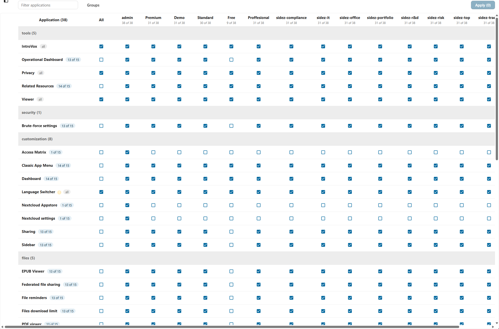
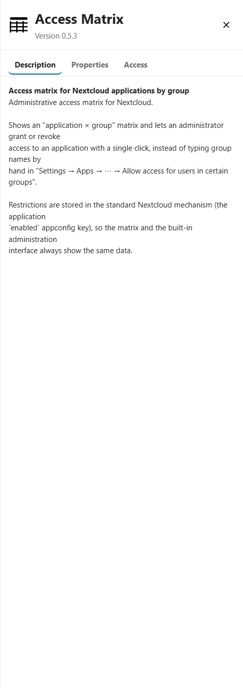

# Access Matrix

**Administrative access matrix for Nextcloud.** Grant or revoke access to applications
per group from a single table, instead of typing group names by hand in
*Settings → Apps → ⋯ → Allow access for users in certain groups*.



---

## English

### What it does



The app adds a section **Matrix** to *Settings → Administration*. It shows every
installed application as a row and every group as a column, so access can be
changed with one click.

- **Master switch per application.** The *All* checkbox turns access on or off for
  all groups of that application at once — and unchecking a single group
  automatically clears *All*.
- **Bulk operations on columns.** Click a group header to select the column,
  hold <kbd>Shift</kbd> to select a range from the anchor column, hold
  <kbd>Ctrl</kbd> to pick columns one by one. Then grant access to all selected
  groups or revoke it from all.
- **Deferred apply.** Changes are staged locally and only written to the server
  when you press *Apply*; rows with pending changes are marked. If a change would
  remove your own access to an application, the app asks for confirmation.
- **Grouping by category.** Applications are grouped by their category from
  `info.xml` (Tools, Security, Files, Integration, …) and each group can be
  collapsed.
- **Visible groups.** Columns can be hidden, and the order of the columns can be
  changed by dragging the headers — the order is stored per user.
- **Application details.** Clicking an application name opens a panel with its
  description, properties and current access.
- **Compatibility warnings.** A few applications treat a group restriction as a
  complete shutdown and hide their interface from everybody, including
  administrators. Such applications are marked with `(!)` in the matrix.

Restrictions are stored in the standard Nextcloud mechanism — the `enabled`
appconfig key of the application — so the matrix and the built-in administration
interface always show the same data.

### Requirements

- Nextcloud 35
- PHP 8.3 or newer
- Node.js 24 or newer (only for building the frontend)

### Installation

#### From the Nextcloud app store

Search for *Access Matrix* in *Apps* and install it.

#### Manual installation

```bash
git clone https://github.com/SIDEZRU/access-matrix.git
cd access-matrix
npm ci
npm run build            # produces js/ and css/
```

Copy the directory into the `custom_apps` folder of your Nextcloud instance
(usually `nextcloud/apps` inside the container) as `access_matrix` and enable it:

```bash
sudo -u www-data php occ app:enable access_matrix
```

### Development

```bash
npm ci
npm run build     # production build
npm run watch     # rebuild on change
npm run lint      # ESLint
```

PHP code follows the Nextcloud coding style; the frontend uses Vue 3 with
`@nextcloud/vue`.


### Tests

```bash
composer install          # dev dependencies: PHPUnit and the OCP stubs
composer test             # PHPUnit — service, parsing of info.xml, access states
npm ci
npm test                  # Vitest — access state logic of the matrix
```
### AI contribution disclosure

This application was developed with AI assistance (Kilo CLI, MiniMax-M3.1-Flash).
The code was reviewed, tested on a live Nextcloud instance and submitted by a human
maintainer. Subsequent commits carry an `Assisted-by:` trailer recording the
assistance.
### License

AGPL-3.0-or-later — see [LICENSE](LICENSE).

---

## Русский

### Что делает


Плагин добавляет в «Параметры сервера» раздел **Матрица доступа**: каждое
установленное приложение — строка, каждая группа — столбец, поэтому доступ
меняется одним кликом.

- **Главный переключатель в строке.** Галочка «Все» включает или выключает
  доступ сразу для всех групп приложения; если снять галочку у отдельной
  группы, «Все» снимается автоматически.
- **Массовые операции по столбцам.** Клик по заголовку группы выделяет столбец,
  <kbd>Shift</kbd> — диапазон от опорного столбца, <kbd>Ctrl</kbd> — выборочное
  выделение. Дальше можно выдать доступ всем выделенным группам или снять его
  у всех.
- **Отложенное применение.** Изменения готовятся локально и записываются на
  сервер только по кнопке «Применить»; строки с несохранёнными изменениями
  помечены. Если правка оставит вас без доступа к приложению, плагин
  предупредит.
- **Разбивка по категориям.** Приложения сгруппированы по категориям из
  `info.xml» (Приложения, Безопасность, Файлы, Интеграция и т. д.), каждый
  раздел можно свернуть.
- **Видимые группы.** Ненужные столбцы можно скрыть, а порядок столбцов —
  изменить перетаскиванием заголовков; порядок сохраняется для каждого
  пользователя.
- **Сведения о приложении.** Клик по названию приложения открывает панель с
  описанием, свойствами и текущим доступом.
- **Предупреждения о совместимости.** Некоторые приложения считают ограничение
  по группам полным отключением и прячут свой интерфейс от всех, включая
  администратора. Такие приложения помечены в матрице знаком `(!)`.

Ограничения хранятся штатным механизмом Nextcloud — в appconfig-ключе `enabled`
приложения, — поэтому матрица и встроенный интерфейс администрирования всегда
показывают одни и те же данные.

### Требования

- Nextcloud 35
- PHP 8.3 или новее
- Node.js 24 или новее (только для сборки фронтенда)

### Установка

#### Из магазина приложений Nextcloud

Найдите *Access Matrix* в разделе «Приложения» и установите.

#### Вручную

```bash
git clone https://github.com/SIDEZRU/access-matrix.git
cd access-matrix
npm ci
npm run build            # собирает js/ и css/
```

Скопируйте каталог в папку `custom_apps` вашего экземпляра Nextcloud (обычно
`nextcloud/apps` внутри контейнера) под именем `access_matrix` и включите
приложение:

```bash
sudo -u www-data php occ app:enable access_matrix
```

### Разработка

```bash
npm ci
npm run build     # продакшн-сборка
npm run watch     # пересборка при изменениях
npm run lint      # ESLint
```

PHP-код следует стилю Nextcloud, фронтенд — Vue 3 с `@nextcloud/vue`.


### Тесты

```bash
composer install          # dev-зависимости: PHPUnit и заглушки OCP
composer test             # PHPUnit — сервис, разбор info.xml, состояния доступа
npm ci
npm test                  # Vitest — логика состояния матрицы
```
### Раскрытие участия ИИ

Приложение разработано с участием ИИ (Kilo CLI, MiniMax-M3.1-Flash). Код проверен,
протестирован на живом экземпляре Nextcloud и отправлен человеком-разработчиком.
В дальнейших коммитах указывается трейлер `Assisted-by:`.
### Лицензия

AGPL-3.0-or-later — см. [LICENSE](LICENSE).
